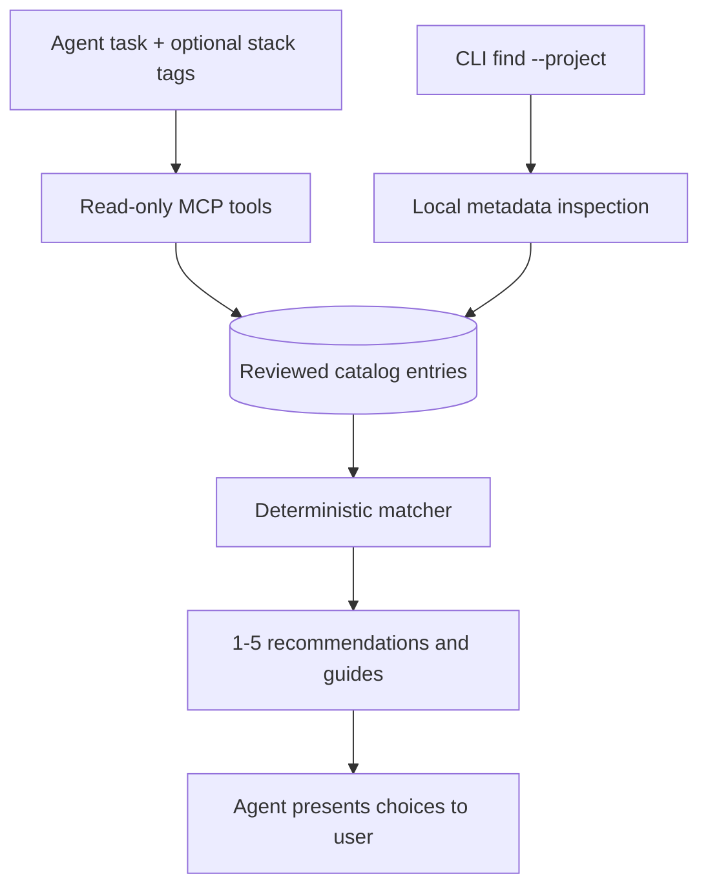

<div align="center">

# ☯ KARMA

### Ask Karma. Get a short list of agent skills worth considering.
**Fit Over Fame • Zero Telemetry • Human Approval First • Multi-Agent Ready**

[](LICENSE)
[](https://pypi.org/project/find-karma/)
[](https://python.org)
[](https://bun.sh)
[](https://skills.sh)
[](https://claude.ai)
[](SKILL.md)

<p align="center">
  <a href="#-quickstart">Quickstart</a> •
  <a href="#-multi-agent-adapters">Multi-Agent Adapters</a> •
  <a href="#-architecture">Architecture</a> •
  <a href="#-curated-catalog--trust">Catalog & Trust</a> •
  <a href="#-security--safety-invariants">Security Policy</a> •
  <a href="#-development--testing">Development</a>
</p>

</div>

---

## ⚡ Overview

Most skill finders answer a narrow coding task with an enormous marketplace. KARMA gives a coding agent **a small, explainable shortlist from a maintained catalog** instead.

The new **KARMA MCP advisor** is intentionally limited to two read-only tools:

1. `recommend_skills`: describe the task and optionally send non-sensitive stack tags; get up to five matching reviewed entries, reasons, sources and installation guides.
2. `get_skill_guide`: request the guide for one reviewed entry by ID.

**That's the full MCP contract.** It does not install, fetch, rank by GitHub stars, read your project's files or execute commands. The agent still needs your approval before acting on any returned installation command. The shipped catalog currently has 45 reviewed entries and 15 candidates that MCP never recommends. `reviewed` means documentation or structure was inspected, not a guarantee of security or performance.

### Connect an MCP client (new)

The MCP server uses **stdio**, so the agent host launches a local `karma-mcp` process. Python 3.11+ is required for the optional MCP SDK; the existing Python 3.10+ CLI stays dependency-free.

From a local checkout of this PR:

```bash
python3 -m pip install '.[mcp]'
karma-mcp
```

`karma-mcp` waits for MCP messages on stdin and writes protocol responses to stdout. It is not an interactive shell command. After this feature is published to PyPI, the installation command will be `pip install 'find-karma[mcp]'`.

OpenAI Codex `config.toml`:

```toml
[mcp_servers.karma]
command = "karma-mcp"
```

Claude Desktop or another host that supports stdio MCP server configuration:

```json
{
  "mcpServers": {
    "karma": { "command": "karma-mcp" }
  }
}
```

Then ask the agent:

```text
Ask Karma which curated skills would help me write regression tests for a React app.
Do not install anything. Show me the recommended skills and their guides.
```

The MCP tool takes `goal` (required), `agent` (`codex`, `claude-code`, `cursor`, `gemini`, `opencode`, `antigravity`, or `windsurf`), optional `project_signals` such as `framework:react` or `language:python`, and `limit` (1-5, default 3). The client supplies only these tags; KARMA never examines the client workspace. Unknown tasks return an empty shortlist rather than pulling arbitrary third-party skills. ChatGPT's web interface cannot directly launch a local stdio server; use a host that supports local MCP configuration.

### Existing standalone skill and CLI

Give your coding agent the prompt:

```text
FIND KARMA ☯
```

And receive a **short, explainable, curated set of skills and plugins** tailored to your repository's tech stack and immediate goal.

KARMA is built with a strict **offline-first and user-sovereignty** philosophy:
- **No external model calls or API keys**: Runs using Python stdlib and fast Bun/Node wrappers.
- **No background telemetry or tracking**: Operates entirely within your local workspace.
- **No surprise installations**: `find` is strictly read-only; `install` is a dry-run preview by default.

---

## 🚀 Quickstart

### 1. Python Package via pip (PyPI)

```bash
pip install find-karma

# Doctor check
karma doctor

# Discover skills for your active project
karma find --project . --goal "Fix React UI quality" --agent codex
```

### 2. Instant Zero-Install (Bun / npx)

```bash
# Doctor check
bunx find-karma doctor
# or
npx find-karma doctor

# Discover skills for your active project
bunx find-karma find --project . --goal "Fix React UI quality" --agent claude-code
```

### 3. Universal Multi-Agent One-Liner

Install KARMA into all detected coding agents on your machine in one command:

```bash
git clone https://github.com/imMamdouhaboammar/karma-skill.git
cd karma-skill
./install.sh
```

Or install directly into a specific project workspace:

```bash
./install.sh --project /path/to/your/project
```

### 4. Local Python Execution

```bash
./bin/karma doctor
./bin/karma find --project . --goal "Security audit and secrets" --agent codex
```

---

## 🔌 Multi-Agent Adapters

KARMA ships with first-class adapter manifests and profiles for the entire AI agent ecosystem:

| Agent Host | Integration Path | Manifest / Config | Discovery Mode |
|---|---|---|---|
| **Claude Code & Desktop** | `.claude/skills/find-karma` | `marketplace.json`, `.claude-plugin/` | Automatic on `FIND KARMA` |
| **OpenAI Codex & ChatGPT** | `.agents/skills/find-karma` | `.codex-plugin/plugin.json` | Automatic via plugin contract |
| **Cursor IDE** | `.cursor/skills/find-karma` | `.cursor/rules/find-karma.mdc` | MDC rule-triggered |
| **Google Antigravity** | `.agent/skills/find-karma` | `skills/find-karma/SKILL.md` | Skill-loop native |
| **Gemini CLI** | `.gemini/skills/find-karma` | `~/.gemini/config/skills/` | CLI skill load |
| **Windsurf** | `.windsurf/skills/find-karma` | `SKILL.md` & workspace rules | Cascading skill |
| **OpenCode** | `.opencode/skills/find-karma` | `skills/find-karma/` | Native skill registry |
| **VS Code (Cline / Roo)** | `.vscode/skills/find-karma` | `.vscode/mcp.json` | Native MCP / Task |
| **GitHub Copilot** | `.github/skills/find-karma` | `.github/copilot-instructions.md` | Contextual instructions |
| **Skills.sh (Vercel)** | Root registry | `.skills.json` | `npx skills add <repo>` |
| **npm / Bun CLI** | Global / Local binary | `package.json` (`bin/cli.js`) | `bunx find-karma` / `karma` |
| **Python Package** | Virtualenv / pip | `pyproject.toml` | `pip install .` (`karma`) |

---

## 🎨 UI-Master Module (Design Engineering & Rust Rig Engine)

KARMA bundles `@ui-master`, an elite design engineering agent weaponized with the 421 `ui-skills` catalog, native Rust Rig AI tools (`rig-core`), and Model Context Protocol (MCP) server.

### 1. Initialize UI-Master for Any Agent
```bash
# Install UI-Master into your active agent workspace
karma init-agent --agent <antigravity|claude-code|cursor|vscode|copilot|codex|windsurf|opencode> --skill ui-master

# Or install both KARMA discovery and UI-Master together:
karma init-agent --agent <agent> --skill all
```

### 2. Deterministic Verification Gates (Native Rust `uim` Engine)
```bash
# Calculate WCAG 2.2 AAA/AA relative luminance and contrast ratio (<1ms)
uim contrast "#0f172a" "#38bdf8" --json

# Scan files for anti-slop violations (h-screen bugs, layout thrashing, typography bloat)
uim audit ./src --json

# Audit Chrome Extension (CRX) Manifest V3, Closed Shadow DOM, and popup bounds
uim crx ./extension --json

# Sub-millisecond BM25 keyword search across 421 design engineering skills
uim skills "micro-interactions motion" --json

# MCP Server mode (Stdio JSON-RPC 2.0 with inputSchema for VS Code / Claude / Cursor)
uim mcp
```

The `uim` launcher first checks for an independent executable on `PATH` or a
local compiled Rust engine. Without one, `contrast` and `audit` use the Python
bridge; `crx`, `skills`, `mcp`, `rig`, `get-skill`, and `trace` run the Rust source
through Cargo automatically when it is present. Cargo is invoked with
`--offline --locked`, so a CLI call does not fetch dependencies. From a full
source checkout, you can explicitly prepare the engine with:

```bash
cargo build --locked --manifest-path crates/ui-master-engine/Cargo.toml
```

This build may fetch Rust crates; the launcher itself never does. A standalone
portable skill does not include the Rust source, so native-only commands need
an independently installed `uim` executable. If the engine or Cargo is missing,
the launcher reports the prerequisite on stderr and exits nonzero. Native
`skills` search also needs a locally populated
`~/.gemini/antigravity/ui-skills-catalog/registry.json`; it is not bundled.

`UIM_CARGO_RUN=1` or `true` selects Cargo for Python-supported commands too
when there is no compiled engine. Unset, `auto`, `0`, and `false` use the default
capability dispatch. Invalid values are rejected. The Python `audit` fallback
currently checks only `h-screen` and is **not a comprehensive accessibility
audit** (tracked in [#5](https://github.com/imMamdouhaboammar/karma-skill/issues/5)).
`uim mcp` runs a stdio server that waits for protocol requests; it is not
expected to exit until stdin closes.

---

## 🏗️ Architecture



Only the standalone CLI offers a separate, explicitly approved `install --execute --yes` command. There is no corresponding MCP installation tool.

---

## 🎯 Usage Examples

### 1. Recommending UI Skills for a React Repository

```bash
./bin/karma find --project ./examples/react-app --goal "frontend UI polish" --agent codex
```

```text
☯ KARMA Recommendations (agent: codex)
1. ui-skills (lane: frontend-quality)
   Why: Detected React 19 + TypeScript dependencies in package.json.
   Source: https://github.com/ibelick/ui-skills
   Installation: npx --yes skills add ibelick/ui-skills -a codex -y
```

### 2. JSON Mode for Orchestrators & Multi-Agent Swarms

```bash
./bin/karma find --project . --goal "TDD testing coverage" --agent claude-code --json
```

---

## 🛡️ Security & Safety Invariants

KARMA strictly adheres to the **Security Best Practices** guidelines:

1. **Read-Mostly Metadata Scan**:
   KARMA scans project manifests (e.g. `package.json`, `Cargo.toml`, `pyproject.toml`, `go.mod`) and filenames. It **never reads credentials, `.env` files, private keys, or source file internals**.

2. **No Unauthenticated Remote Execution**:
   No code is executed remotely. Running `find` never makes outbound HTTP calls or downloads packages.

3. **Dry-Run by Default**:
   `karma install` prints a dry-run preview command. It will refuse to invoke external commands unless both `--execute` and `--yes` are explicitly passed.

4. **Symlink Boundary Protection**:
   Directory symlinks outside the repository root are ignored during project inspection, and `init-agent` strictly refuses to write through symlinked agent target directories.

5. **Untrusted Data Isolation**:
   GitHub API responses during optional `sync-stars` are stored in `.karma/starred-candidates.json` for human inspection and are strictly forbidden from automatic catalog promotion or script execution.

---

## 📦 Curated Catalog & Trust

Sources include tested skills and tools from across the ecosystem:
- `mattpocock/skills` (TDD, Engineering workflow)
- `trailofbits/skills` (Security audits, Vulnerability verification)
- `K-Dense-AI/scientific-agent-skills` (Scientific research, Literature reproduction)
- `imMamdouhaboammar/dokion` (Supply chain security & provenance)
- `ai-evals-course/evals-skills` (Evaluation suites)
- `ibelick/ui-skills` (Modern visual UI & React craft)
- `cisco-ai-defense/skill-scanner` (Agent skill security scanning)

> **Note**: `reviewed` indicates catalog maintainers verified the structure, license, and repository metadata. It is not an endorsement of unverified third-party HEAD revisions.

---

## 🧪 Development & Testing

Ensure all tests pass before making contributions:

```bash
# Build portable artifacts
python3 scripts/build_skill.py

# Run Bun CLI tests
bun test

# Run Python unittest suite
PYTHONPATH=src python3 -m unittest discover -s tests -v

# Validate catalog constraints
PYTHONPATH=src python3 -m karma validate
```

---

## 📄 License

MIT © 2026 [Mamdouh Aboammar](https://github.com/imMamdouhaboammar)
